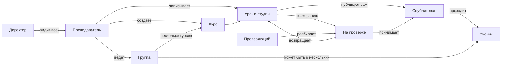

# Дизайн-документ платформы тренажёра

Дата: 06.11.2026

Продуктовый дизайн: роли, кабинеты, курсы, группы и необязательная проверка. Документ догоняет уже написанный код и фиксирует, как система должна работать. Технический план и вехи см. в [platform-plan.md](platform-plan.md).

## О системе

Платформа тренажёра — среда, в которой преподаватель снимает работу с настоящей веб-системой и превращает запись в учебный урок. Уроки складываются в курсы, курсы назначаются группам учеников. Ученик проходит опубликованные уроки в тренажёре: видит те же экраны и делает те же действия, но не заходит в боевую систему.

Первый предмет — Единая информационная система госзакупок (ЕИС). Сама платформа общая: тем же способом можно собрать тренажёр другой веб-системы, если с неё удаётся записать экраны и действия.

Зачем это нужно: научить людей сложному интерфейсу без доступа к боевой среде, без риска испортить данные и без ожидания отдельной учебной площадки. Преподаватель ведёт свои курсы и группы, проверяющий по желанию принимает уроки, директор видит работу преподавателей, администратор настраивает платформу.

## Имена и пакеты

Продукт называется uitrainer: это тренажёр, а не только съёмка экрана. Имена в коде построены вокруг продукта. Репозиторий и приложения остаются в личном аккаунте, не в организации digitilius. Репозиторий на GitHub и Origin пока называется `ui-capture`; это отдельное ручное переименование, в этом изменении его нет.

| Что | В коде | Без изменений |
| --- | --- | --- |
| Репозиторий | `stasmakarov/ui-capture` и Origin `stanislav-makarov/ui-capture` | не переименован |
| npm CLI | пакет `uitrainer`, вызов `npx uitrainer`, файл `bin/uitrainer.js` | |
| Пакеты монорепо | `@uitrainer/studio`, `@uitrainer/player`, `@uitrainer/lesson-schema`, `@uitrainer/student-portal` | папки `studio`, `player`, `lesson-schema`, `student-portal` те же |
| Java | group `io.uitrainer`, пакет `io.uitrainer.platform`, артефакт `uitrainer-platform`, класс `UiTrainerPlatformApplication`, тема Vaadin `uitrainer` | |
| Схема запуска студии | `uitrainer://`; кнопка «Записать в студии» открывает её | NSIS регистрирует протокол; на Mac каркас в `studio/macos/` |
| Переменные окружения | `UITRAINER_DB_URL`, `UITRAINER_PUBLIC_URL`, `UITRAINER_FILES_DIR`, `UITRAINER_TEST_DB_URL`, `UITRAINER_DEV_DBADMIN_*`, `UITRAINER_MODEL_DIR`, `UITRAINER_STUDIO_TOKEN`, `UITRAINER_PLATFORM_URL`, `UITRAINER_HEADLESS` и остальные `UITRAINER_*` | короткого `UIT_*` нет |
| Jmix `projectId` | `uic` | не меняется: от него зависят префиксы таблиц `UIC_*` и id экранов `uic_` |
| Формат `.lesson.zip` | `ui-capture-lesson` | строка в манифесте не меняется, уже собранные пакеты читаются |
| Локальная БД dev | роль, базы `uicapture` и `uicapture_test`, volume `uicapture-pg` | не меняются, чтобы существующий Docker volume продолжал работать |
| Liquibase | каталог `io/uicapture/platform/liquibase`, author изменений `ui-capture` | путь и author не меняются: по ним Liquibase узнаёт уже применённые изменения |
| Префиксы токена и тикета | `uicst_`, `uictk_` | не меняются: уже выданные токены и тикеты остаются действительными |
| Каталог модели речи | `.uitrainer/models` | |
| Микрофон в браузере | ключи `uitrainer-mic` и `uitrainer-mic-ready` | |
| `$id` JSON Schema | `https://cursor.com/codebase/stanislav-makarov/ui-capture/lesson.schema.json` | в адресе остаётся имя репозитория |

Короткий префикс `UIT_*` не используем.

## Роли

Роли назначаются пользователю. Отдельных сущностей «преподаватель», «проверяющий» и «директор» нет.

| Роль | Кто это | Что видит при входе | Чего не делает |
| --- | --- | --- | --- |
| Преподаватель | Пользователь с ролью тренера. Ведёт свои курсы и записывает уроки | Свои курсы, группы и сводку по урокам | Не видит чужие курсы, токены студии и общий список всех уроков |
| Проверяющий | Пользователь с ролью reviewer. Не обязательный участник публикации | Очередь уроков, отправленных на проверку; она может быть пустой | Не создаёт курсы и группы, не записывает в студии, не раздаёт права |
| Ученик | Пользователь с ролью ученика. Может быть сразу в нескольких группах | Активные группы и доступные в них курсы, свой прогресс | Не видит черновики, проверку, токены, чужие курсы и закрытые группы на дашборде |
| Директор | Пользователь с ролью директора: смотрит всех преподавателей, но не настраивает систему | Список всех преподавателей, их курсы и активные группы | Не выдаёт роли, не правит токены студии и не записывает уроки |
| Администратор | Пользователь с полным доступом к настройке платформы | Кабинет: преподаватели и число их курсов, переход к пользователям и ролям | Токены студии не на старте, а в разделе Администрирование |

## Стартовые экраны

Таблица «Роли» выше — целевая картина, включая группы. Этот раздел описывает кабинеты, которые открываются сейчас.

После входа пользователь попадает в кабинет роли, а не в общий список сущностей. Переключателя ролей нет. Если ролей несколько, выполняется такое правило приоритета: **администратор → директор → преподаватель → проверяющий → ученик**. Меню остальных ролей остаётся: например, преподаватель с ролью проверяющего открывает кабинет преподавателя, а очередь проверки доступна отдельным пунктом меню.

Портала ученика на React нет: ученик пока работает в кабинете платформы.

Демо-вход в профиле `dev` (пароль совпадает с логином): `admin` / `admin`, `trainer` / `trainer`, `reviewer` / `reviewer`, `student` / `student`, `director` / `director`. `trainer2` / `trainer2` — второй преподаватель, чтобы чужие курсы не попадали в чужой кабинет. У `trainer` есть два демо-курса и активная группа «Демо-группа» в режиме «по очереди» с учеником `student`. В первом курсе — черновик, опубликованный урок, урок на проверке и возвращённый черновик; это строки без пакета студии, предпросмотра файла у них нет.

### Преподаватель

Свои группы (созданные и активные) с числом учеников и сводкой прогресса, свои курсы. Закрытые группы — в истории. Счётчики черновиков и опубликованных есть всегда. «На проверке» и «возвращены» появляются, только если такие уроки есть. Счётчик открывает очередь этих уроков. Главное действие — «Создать группу»; «Создать курс» рядом. Карточка группы: ученики, курсы и порядок, режим, активация и закрытие.

На кабинете и в меню нет: кнопки «создать урок» со старта, общего списка «Уроки», чужих курсов, токенов студии.

### Проверяющий

Стартовый экран — очередь приёмки. В ней уроки «на проверке»: курс, преподаватель, когда отправили. Рядом счётчики «ожидают» и «принято или возвращено сегодня». Из строки можно открыть урок, предпросмотр, опубликовать или вернуть с обязательным комментарием. Пустая очередь — обычная ситуация: автор может опубликовать урок сам.

Пункт «Курсы» — справочник только для чтения, не кабинет. Создавать курсы и группы и записывать в студии нельзя.

### Администратор

Кабинет платформы: преподаватели (пользователи с ролью тренера), число их курсов и активных групп. Можно открыть преподавателя, его курс и любую его группу. Есть ссылки на пользователей и роли, создание преподавателя и назначение ролей. На том же экране — очередь уроков, как у проверяющего.

Токены студии остаются в разделе «Администрирование», не на старте. Отдельного справочника проверяющих нет: проверяющий — роль на пользователе.

### Директор

Список всех преподавателей, число их курсов и активных групп. Открытие преподавателя показывает курсы и группы только для чтения. Закрытые группы видны через фильтр.

Выдавать роли, править токены студии и записывать уроки нельзя.

### Ученик

Пока нет React-портала: активные группы, только открытые курсы с прогрессом, «начать урок» и «отметить пройденным». Черновиков, статусов проверки, токенов и админки на этом экране нет. Заблокированный в последовательном режиме курс не показывается.

### Чего на кабинетах нет

- React-портал ученика.
- Приглашения в группу по ссылке или коду.
- Совладельцы группы, обязательные уроки, процентный порог, оценки.

## Группы

Группа — поток учеников, на который назначают несколько курсов. Один ученик может входить в несколько групп; прогресс считается внутри каждой группы отдельно, даже если курс совпадает.

| Правило | Как работает |
| --- | --- |
| Курсы | На группу назначают один или несколько курсов и задают их порядок кнопками «Выше» / «Ниже»; номер хранится до сохранения группы |
| Все курсы сразу | После активации группы ученик видит все назначенные курсы |
| Последовательный доступ | Следующий курс открывается этому ученику, только когда он прошёл предыдущий. У одногруппников прогресс свой |
| Создана | Группу собирают: курсы, ученики, режим. Курсы ученикам ещё недоступны |
| Активна | Курсы доступны по выбранному режиму. Группа на дашборде преподавателя |
| Закрыта | Только в истории у преподавателя, не на рабочем дашборде ученика |
| Курс пройден | Все текущие PUBLISHED-уроки курса имеют `LessonAttempt.completedAt` у этого ученика (попытки общие, не привязаны к группе), либо в группе уже стоит снимок `GroupCourseProgress.COMPLETED`. Новые уроки после снимка курс не переоткрывают |
| Пустой курс | Курс без PUBLISHED-уроков ученику не показывают и в последовательном режиме он не блокирует следующие |
| Удаление из группы | Удаление ученика или курса из группы стирает `GroupCourseProgress` этой группы. `LessonAttempt` остаётся — это история ученика |
| Прохождение урока | `LessonAttempt`: ученик, урок, закреплённая версия, с которой начал, `startedAt` / `completedAt`. После публикации новой версии ученик открывает ту, с которой начал; новые ученики — текущую опубликованную |

## Что уже есть и чего ещё нет

| Тема | Сейчас в коде | Как должно быть |
| --- | --- | --- |
| Роли | Администратор, преподаватель, проверяющий, ученик, директор. Директор видит преподавателей, курсы и группы, не выдаёт роли, не правит токены и не записывает уроки | Отдельных справочников преподавателя и проверяющего нет |
| Курсы и уроки | Курс с владельцем, уроки и статусы. У преподавателя нет пункта «Уроки»: уроки открываются из курса и из очереди счётчиков | То же |
| Проверка | Из черновика автор публикует сам; отправка на проверку необязательна | То же |
| Студия | Запись локально, публикация на сервер по одноразовому тикету | Тикет скрыт: кнопка «Записать в студии» открывает студию сама |
| Экраны после входа | Кабинет по роли, см. «Стартовые экраны». Несколько ролей: администратор → директор → преподаватель → проверяющий → ученик | То же. React-портала ученика нет |
| Группы и прогресс | Группа преподавателя, курсы с порядком, ученики, статусы создана / активна / закрыта, режимы все сразу / по очереди, прогресс ученик × группа × курс, прохождение урока с фиксацией версии | Приглашения по ссылке или коду — следующий шаг |
| Кабинет ученика | Vaadin: свои активные группы и открытые курсы с прогрессом | Отдельный портал |

## Сквозной поток

Преподаватель создаёт курсы и группу, назначает на группу несколько курсов, записывает уроки и может сразу их опубликовать. Группу активируют — ученики видят курсы сразу все или по одному, как пройдут предыдущий. Проверка необязательна. Директор видит всех преподавателей, администратор настраивает платформу.

## Как связаны роли

## Модель данных

Пользователь несёт роли. Курс принадлежит преподавателю и состоит из уроков с версиями. Группа принадлежит преподавателю, на неё назначают курсы с порядком и учеников. Прогресс хранится как ученик × группа × курс, чтобы последовательное открытие и несколько групп не смешивались.

| Сущность | Главное |
| --- | --- |
| Пользователь | Логин, имя, роли: преподаватель, проверяющий, ученик, директор, администратор |
| Курс | Название, код, описание, владелец-преподаватель, уроки. Порядок уроков задаётся колонкой «№» и кнопками «Выше» / «Ниже» |
| Урок | Курс, автор, статус, номер в курсе, текущая и опубликованная версии, журнал переходов. Ученик видит «Урок N. …» |
| Группа | Владелец, статус создана / активна / закрыта, режим: все курсы сразу или по порядку |
| Назначение курса | Связь группы с курсом и порядком в последовательном режиме |
| Участник группы | Связь группы с учеником; ученик может быть в нескольких группах |
| Прогресс | Ученик, группа, курс: не начат / начат / пройден. Снимок «пройден» в группе; факт прохождения уроков — в `LessonAttempt` |
| Прохождение урока | Ученик, урок, версия `LessonVersion`, начало и завершение |

## Права

| Действие | Преподаватель | Проверяющий | Ученик | Директор | Администратор |
| --- | --- | --- | --- | --- | --- |
| Свои курсы и уроки | Да: свои, где соавтор, и доступные для ведения | Все, просмотр | Нет | Все, просмотр | Да |
| Записать урок в студии | Да, в свой курс или как соавтор. «Ведение» — нет | Нет | Нет | Нет | Да |
| Опубликовать урок самому | Да, свой или как соавтор | Да, из очереди | Нет | Нет | Да |
| Отправить на проверку | Да, по желанию | Нет | Нет | Нет | Да |
| Вернуть с проверки | Свой урок | Да | Нет | Нет | Да |
| Поставить курс в группу | Свой, соавторский или доступный для ведения | Нет | Нет | Нет | Любой курс в любую группу |
| Активировать и закрыть группу | Свою | Нет | Нет | Нет | Да |
| Проходить доступные курсы | Нет | Нет | Да | Нет | Нет |
| Видеть всех преподавателей | Нет | Нет | Нет | Да | Да |
| Роли и токены студии | Нет | Нет | Нет | Нет | Да |

## Таблица use cases

| Код | Роль | Сценарий | Цель | Откуда входит | Основные шаги | Результат | Примечание |
| --- | --- | --- | --- | --- | --- | --- | --- |
| UC-T1 | Преподаватель | Открыть свой кабинет | Увидеть состояние своей работы, а не общий CRUD | После входа — стартовый экран преподавателя | Система показывает его курсы, группы в статусах «создана» и «активна» и сводку уроков: черновики и опубликованные; если используется проверка — также «на проверке» и возвращённые | Понятно, что делать дальше; чужих курсов и токенов нет | Закрытых групп на дашборде нет — только в истории |
| UC-T2 | Преподаватель | Создать курс | Завести новый курс, где будут уроки | Кнопка «Создать курс» на стартовом экране | Указывает название, код, описание; владелец проставляется сам | Курс появился в его списке | Чужой курс создать нельзя |
| UC-T3 | Преподаватель | Открыть свой курс | Увидеть состав уроков и работать с курсом | Строка курса на стартовом экране или в списке курсов | Открывает карточку: название, код, описание, таблица своих уроков | Можно править курс и перейти к уроку или записи | |
| UC-T4 | Преподаватель | Записать урок в студии | Снять урок для конкретного курса | Кнопка «Записать в студии» в карточке курса | Открывается студия уже от его имени и для этого курса; он записывает и публикует на сервер | У курса появился урок-черновик | Тикет обмена скрыт; отдельно «создать урок» с главного экрана нет |
| UC-T9 | Преподаватель | Опубликовать урок самому | Сделать урок доступным ученикам без проверки | Карточка своего урока в статусе «черновик» | Нажимает «Опубликовать» | Урок сразу доступен ученикам групп этого курса | Основной путь, если проверка не нужна |
| UC-T5 | Преподаватель | Отправить урок на проверку | По желанию передать черновик проверяющему | Карточка своего урока в статусе «черновик» | Нажимает действие перехода в статус «на проверке» | Урок попадает в очередь проверяющего | Необязательный шаг: автор может опубликовать сам, без очереди |
| UC-T6 | Преподаватель | Доработать возвращённый урок | Учесть комментарий проверки и отправить снова | Сводка «возвращены» на стартовом экране | Открывает урок, читает комментарий в журнале, правит и снова отправляет на проверку | Урок снова «на проверке» | Нужен только если урок отправляли на проверку и его вернули |
| UC-T7 | Преподаватель | Создать группу и набрать учеников | Собрать поток на один или несколько курсов | Кнопка «Создать группу» на старте | Задаёт название, назначает несколько своих курсов, выбирает режим доступа и добавляет учеников. Группа создаётся в статусе «создана» | Группа есть, но курсы ученикам ещё недоступны, пока группу не активируют | Ученик может состоять в нескольких группах |
| UC-T8 | Преподаватель | Смотреть прогресс группы | Понять, кто из учеников на чём остановился | Карточка активной группы | Смотрит учеников и прохождение каждого курса группы. В последовательном режиме видно, на каком курсе кто стоит | Прогресс считается для каждого ученика отдельно, в рамках этой группы | Если ученик в двух группах, прогресс по каждой независим |
| UC-T10 | Преподаватель | Активировать или закрыть группу | Открыть ученикам доступ к курсам или убрать группу с дашборда | Карточка группы | Из «создана» переводит в «активна» — курсы становятся доступны. Из «активна» — в «закрыта» | Активная группа видна ученикам; закрытая уходит в историю и исчезает с дашборда преподавателя | |
| UC-R1 | Проверяющий | Открыть очередь приёмки | Увидеть, что ждёт проверки | После входа — стартовый экран проверяющего | Система показывает уроки «на проверке»: курс, преподаватель, когда отправили; рядом счётчики очереди | Понятно, что разбирать сейчас | Очередь может быть пустой: проверка необязательна, авторы часто публикуют сами |
| UC-R2 | Проверяющий | Просмотреть урок | Оценить материал перед решением | Строка урока в очереди | Открывает карточку, смотрит версии, предпросмотр и журнал | Достаточно данных, чтобы принять или вернуть | Править курс и записывать в студии нельзя |
| UC-R3 | Проверяющий | Опубликовать урок | Одобрить материал для учеников | Карточка урока «на проверке» | Нажимает «Опубликовать» | Урок становится доступен ученикам групп этого курса | Если автор опубликовал сам, этого шага нет |
| UC-R4 | Проверяющий | Вернуть урок на доработку | Объяснить автору, что исправить | Карточка урока «на проверке» | Возвращает в черновик с обязательным комментарием | У преподавателя урок снова в черновиках с пояснением | Без комментария вернуть нельзя |
| UC-R5 | Проверяющий | Архивировать урок | Снять опубликованный урок с глаз учеников | Карточка опубликованного урока | Переводит в архив | Ученики больше не видят урок как назначенный | |
| UC-R6 | Проверяющий | Посмотреть курсы как справочник | Понять, у кого какие курсы ведутся | Вторичный пункт «Курсы», не стартовый экран | Открывает список и карточку только для чтения | Виден состав курса без права менять его | Не главное рабочее место |
| UC-S1 | Ученик | Увидеть своё обучение | Понять, что назначено сейчас | После входа — стартовый экран ученика | Видит активные группы, куда его записали — их может быть несколько. В каждой — назначенные курсы и свой прогресс. В последовательном режиме следующий курс открыт, только когда он прошёл предыдущий | Нет чужих курсов, статусов проверки и админки | Закрытые группы — только в истории. Видны только опубликованные уроки |
| UC-S2 | Ученик | Открыть следующий урок | Продолжить обучение | Курс или кнопка «Продолжить» на старте | Открывает опубликованный урок и проходит его | Прогресс обновляется | Единственное основное действие ученика. Заблокированный следующий курс открыть нельзя |
| UC-D1 | Директор | Открыть кабинет директора | Видеть всех преподавателей, не настраивая платформу | После входа — стартовый экран директора | Видит список всех преподавателей и число их курсов и активных групп | Можно открыть преподавателя и посмотреть его работу | Это не администратор: нет токенов, ролей и настроек системы |
| UC-D2 | Директор | Посмотреть курсы и группы преподавателя | Понять нагрузку и прогресс по группам | Карточка преподавателя | Открывает курсы и группы, смотрит прогресс учеников без права править состав | Видна картина по всем преподавателям, не только своя | Записывать уроки и выдавать роли не может |
| UC-A1 | Администратор | Открыть кабинет платформы | Увидеть, кто что ведёт, без свалки CRUD | После входа — стартовый экран администратора | Видит преподавателей и число их курсов, при необходимости — очередь уроков как у проверяющего | Можно перейти к преподавателю, курсу или настройкам | Токены студии в разделе «Администрирование», не на старте |
| UC-A2 | Администратор | Смотреть преподавателей и их курсы | Найти преподавателя и понять нагрузку | Список преподавателей со старта или из меню | В списке — имя, логин, число курсов; в карточке — таблица его курсов | Можно открыть курс преподавателя | Преподаватель — пользователь с ролью тренера, не отдельная сущность. Отдельного справочника проверяющих нет |
| UC-A3 | Администратор | Выдать роль пользователю | Сделать человека преподавателем, проверяющим, директором или учеником | Администрирование / безопасность | Создаёт или открывает пользователя и назначает роль | У человека меняется стартовый экран и доступ | Проверяющий — роль на том же пользователе, не справочник |

## Правила и открытые вопросы

Чтобы группы не разъехались, в документе оставлены ещё не закрытые решения. Пока их нет, в реализации лучше не додумывать молча.

| Тема | Статус |
| --- | --- |
| Что значит «курс пройден» для открытия следующего | Все текущие PUBLISHED-уроки с `LessonAttempt.completedAt` или снимок COMPLETED в группе |
| Как показать заблокированный курс | Скрыть: ученик видит только доступные курсы |
| Кто владеет группой | Предложение: преподаватель, который её создал; совладельцев пока нет |
| Видит ли директор закрытые группы | Открытый вопрос: только активные или ещё историю |
| Может ли два преподавателя вести одну группу | Открытый вопрос |
| Соавторы и «доступен другим преподавателям» | Владелец и соавторы правят курс и уроки. «Вести» (поставить в свою группу, прогресс своих учеников) — по sharing: нет / всем преподавателям / выбранным. Черновики видят только владелец и соавторы. Если доступ забрали, уже стоящий в группе курс остаётся у учеников, повторно добавить нельзя. Новая опубликованная версия урока доходит во все группы с этим курсом; начатый урок остаётся на версии из `LessonAttempt` |

## Установщик студии и версии API

Windows: Electron + NSIS, пакет `@uitrainer/desktop`. Папка данных и порт задаются в мастере установки (по умолчанию `Документы\uitrainer` и `44731`), хранятся в `%APPDATA%\uitrainer Studio\config.json`. При первом запуске значения берутся из `HKCU\Software\uitrainer Studio`, если `config.json` ещё нет. Обновление и удаление не трогают папку данных. Chromium в установщик не вкладывается: системный Chrome или Яндекс Браузер и кнопка «Скачать Chromium».

Релизы раздаёт платформа (`UIC_STUDIO_RELEASE`), не GitHub Releases: только текущая версия для `win`. `GET /api/version` отдаёт `platformVersion` (build info), `apiVersion` (константа `ApiVersion.CURRENT = 1`) и ссылку на текущий установщик. Студия при обмене тикета передаёт свой порт; платформа пишет его в `User.studioLocalPort` для запасного пинга `127.0.0.1`. Совместимость API пока — равенство major (`isApiCompatible`).

## Границы продуктов

Студия работает локально и только пишет уроки. Кабинеты преподавателя, проверяющего, директора и администратора живут в админке. Ученик идёт в отдельный портал. Пользователь не работает с тикетами студии: кнопка «Записать в студии» открывает студию сама. У преподавателя нет общего списка всех уроков в меню. Проверяющий и директор — роли на пользователе, не отдельные справочники.
