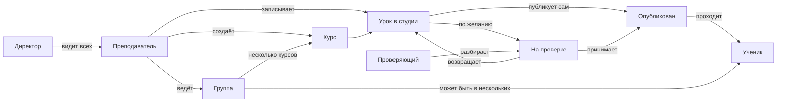

# Дизайн-документ платформы тренажёра

Дата: 06.11.2026

Продуктовый дизайн: роли, кабинеты, курсы, группы и необязательная проверка. Документ догоняет уже написанный код и фиксирует, как система должна работать. Технический план и вехи см. в [platform-plan.md](platform-plan.md).

## О системе

Платформа тренажёра — среда, в которой преподаватель снимает работу с настоящей веб-системой и превращает запись в учебный урок. Уроки складываются в курсы, курсы назначаются группам учеников. Ученик проходит опубликованные уроки в тренажёре: видит те же экраны и делает те же действия, но не заходит в боевую систему.

Первый предмет — Единая информационная система госзакупок (ЕИС). Сама платформа общая: тем же способом можно собрать тренажёр другой веб-системы, если с неё удаётся записать экраны и действия.

Зачем это нужно: научить людей сложному интерфейсу без доступа к боевой среде, без риска испортить данные и без ожидания отдельной учебной площадки. Преподаватель ведёт свои курсы и группы, проверяющий по желанию принимает уроки, директор видит работу преподавателей, администратор настраивает платформу.

## Имена и пакеты

Продукт называется uitrainer, а не uicapture: это тренажёр, а не только съёмка экрана. Имена строим вокруг продукта. Репозиторий и приложения остаются в личном аккаунте, не в организации digitilius.

| Что | Сейчас | Должно стать |
| --- | --- | --- |
| Репозиторий | `stasmakarov/ui-capture` и Origin `stanislav-makarov/ui-capture` | `stasmakarov/uitrainer` и `stanislav-makarov/uitrainer`; GitHub сохранит редирект |
| npm CLI | пакет `ui-capture`, вызов `npx ui-capture` | пакет `uitrainer`, вызов `npx uitrainer` |
| Пакеты монорепо | `@ui-capture/studio`, `player`, `lesson-schema`, `student-portal` | `@uitrainer/studio`, `@uitrainer/player`, `@uitrainer/lesson-schema`, `@uitrainer/student-portal`; папки не переименовывать |
| Java | group `io.uicapture`, пакет `io.uicapture.platform`, артефакт `ui-capture-platform` | `io.uitrainer`, `io.uitrainer.platform`, `uitrainer-platform` |
| Схема запуска студии | `uicapture://` | `uitrainer://`, на переходный период алиас `uicapture://` |
| Переменные окружения | `UIC_DB_URL`, `UIC_PUBLIC_URL` и другие `UIC_*` | `UITRAINER_DB_URL`, `UITRAINER_PUBLIC_URL`; старые `UIC_*` какое-то время принимать как запасные |

Короткий префикс `UIT_*` не используем. Имя `uitrainer` на npm сейчас свободно. Jmix `projectId` `uic` пока не трогаем: он завязан на служебные префиксы, это отдельное решение.

### Что менять в коде

Само переименование репозиториев на GitHub и Origin — вручную. В коде:

| Где менять | Что сделать |
| --- | --- |
| Корень | `name` и `bin` в `package.json`, файл `bin/ui-capture.js`, вызовы в README и скриптах |
| `studio`, `player`, `lesson-schema`, `student-portal` | поле `name` и зависимости `@ui-capture/...` в `package.json` |
| `platform-backend` | `settings.gradle`, `group` в `build.gradle`, каталог и пакет `io.uicapture.platform`, класс `UiCapturePlatformApplication`, ресурсы messages и menu |
| Студия и админка | разбор ссылки в `launchUrl`, диалоги запуска, `studio/macos`, запасной алиас `uicapture://` |
| Конфиг | `UIC_*` в `docker-compose`, `application.properties` и доках; добавить чтение `UITRAINER_*` и оставить `UIC_*` как запасные |
| Документы | README и `docs`: заменить примеры команд и старые имена |
| GitHub и Origin | переименовать репозитории вручную, локально сменить remote |

## Роли

Роли назначаются пользователю. Отдельных сущностей «преподаватель», «проверяющий» и «директор» нет.

| Роль | Кто это | Что видит при входе | Чего не делает |
| --- | --- | --- | --- |
| Преподаватель | Пользователь с ролью тренера. Ведёт свои курсы и записывает уроки | Свои курсы, группы и сводку по урокам | Не видит чужие курсы, токены студии и общий список всех уроков |
| Проверяющий | Пользователь с ролью reviewer. Не обязательный участник публикации | Очередь уроков, отправленных на проверку; она может быть пустой | Не создаёт курсы и группы, не записывает в студии, не раздаёт права |
| Ученик | Пользователь с ролью ученика. Может быть сразу в нескольких группах | Активные группы и доступные в них курсы, свой прогресс | Не видит черновики, проверку, токены, чужие курсы и закрытые группы на дашборде |
| Директор | Пользователь с ролью директора: смотрит всех преподавателей, но не настраивает систему | Список всех преподавателей, их курсы и активные группы | Не выдаёт роли, не правит токены студии и не записывает уроки |
| Администратор | Пользователь с полным доступом к настройке платформы | Кабинет: преподаватели и число их курсов, переход к пользователям и ролям | Токены студии не на старте, а в разделе Администрирование |

## Группы

Группа — поток учеников, на который назначают несколько курсов. Один ученик может входить в несколько групп; прогресс считается внутри каждой группы отдельно, даже если курс совпадает.

| Правило | Как работает |
| --- | --- |
| Курсы | На группу назначают один или несколько курсов и задают их порядок |
| Все курсы сразу | После активации группы ученик видит все назначенные курсы |
| Последовательный доступ | Следующий курс открывается этому ученику, только когда он прошёл предыдущий. У одногруппников прогресс свой |
| Создана | Группу собирают: курсы, ученики, режим. Курсы ученикам ещё недоступны |
| Активна | Курсы доступны по выбранному режиму. Группа на дашборде преподавателя |
| Закрыта | Только в истории у преподавателя и ученика, не на рабочем дашборде |

## Что уже есть и чего ещё нет

| Тема | Сейчас в коде | Как должно быть |
| --- | --- | --- |
| Роли | Администратор, преподаватель, проверяющий, ученик | Плюс директор: видит всех преподавателей, не настраивает систему |
| Курсы и уроки | Курс с владельцем, уроки, версии, статусы черновик / на проверке / опубликован / архив | То же; у преподавателя вход через курс, а не через общий список уроков |
| Проверка | Из черновика можно уйти только на проверку, потом публикация | Проверка необязательна: преподаватель публикует сам |
| Студия | Запись локально, публикация на сервер по одноразовому тикету | Тикет скрыт: кнопка «Записать в студии» открывает студию сама |
| Экраны после входа | Общие списки курсов и уроков | Стартовый кабинет по роли |
| Группы и прогресс | Нет | Несколько курсов на группу, два режима доступа, статусы создана / активна / закрыта, прогресс ученика в группе |
| Кабинет ученика | В админке видит опубликованные уроки | Отдельный портал: свои активные группы и доступные курсы |

## Сквозной поток

Преподаватель создаёт курсы и группу, назначает на группу несколько курсов, записывает уроки и может сразу их опубликовать. Группу активируют — ученики видят курсы сразу все или по одному, как пройдут предыдущий. Проверка необязательна. Директор видит всех преподавателей, администратор настраивает платформу.

## Как связаны роли

## Модель данных

Пользователь несёт роли. Курс принадлежит преподавателю и состоит из уроков с версиями. Группа принадлежит преподавателю, на неё назначают курсы с порядком и учеников. Прогресс хранится как ученик × группа × курс, чтобы последовательное открытие и несколько групп не смешивались.

| Сущность | Главное |
| --- | --- |
| Пользователь | Логин, имя, роли: преподаватель, проверяющий, ученик, директор, администратор |
| Курс | Название, код, описание, владелец-преподаватель, уроки |
| Урок | Курс, автор, статус, текущая и опубликованная версии, журнал переходов |
| Группа | Владелец, статус создана / активна / закрыта, режим: все курсы сразу или по порядку |
| Назначение курса | Связь группы с курсом и порядком в последовательном режиме |
| Участник группы | Связь группы с учеником; ученик может быть в нескольких группах |
| Прогресс | Ученик, группа, курс: не начат / начат / пройден. Считается только внутри этой группы |

## Права

| Действие | Преподаватель | Проверяющий | Ученик | Директор | Администратор |
| --- | --- | --- | --- | --- | --- |
| Свои курсы и уроки | Да | Все, просмотр | Нет | Все, просмотр | Да |
| Записать урок в студии | Да, в свой курс | Нет | Нет | Нет | Да |
| Опубликовать урок самому | Да, свой | Да, из очереди | Нет | Нет | Да |
| Отправить на проверку | Да, по желанию | Нет | Нет | Нет | Да |
| Вернуть с проверки | Свой урок | Да | Нет | Нет | Да |
| Создать и вести группу | Свою | Нет | Нет | Просмотр | Да |
| Активировать и закрыть группу | Свою | Нет | Нет | Нет | Да |
| Проходить доступные курсы | Нет | Нет | Да | Нет | Нет |
| Видеть всех преподавателей | Нет | Нет | Нет | Да | Да |
| Роли и токены студии | Нет | Нет | Нет | Нет | Да |

## Таблица use cases

| Код | Роль | Сценарий | Цель | Откуда входит | Основные шаги | Результат | Примечание |
| --- | --- | --- | --- | --- | --- | --- | --- |
| UC-T1 | Преподаватель | Открыть свой кабинет | Увидеть состояние своей работы, а не общий CRUD | После входа — стартовый экран преподавателя | Система показывает его курсы, группы в статусах «создана» и «активна» и сводку уроков: черновики и опубликованные; если используется проверка — также «на проверке» и возвращённые | Понятно, что делать дальше; чужих курсов и токенов нет | Закрытых групп на дашборде нет — только в истории |
| UC-T2 | Преподаватель | Создать курс | Завести новый курс, где будут уроки | Кнопка «Создать курс» на стартовом экране | Указывает название, код, описание; владелец проставляется сам | Курс появился в его списке | Чужой курс создать нельзя |
| UC-T3 | Преподаватель | Открыть свой курс | Увидеть состав уроков и работать с курсом | Строка курса на стартовом экране или в списке курсов | Открывает карточку: название, код, описание, таблица своих уроков | Можно править курс и перейти к уроку или записи | |
| UC-T4 | Преподаватель | Записать урок в студии | Снять урок для конкретного курса | Кнопка «Записать в студии» в карточке курса | Открывается студия уже от его имени и для этого курса; он записывает и публикует на сервер | У курса появился урок-черновик | Тикет обмена скрыт; отдельно «создать урок» с главного экрана нет |
| UC-T9 | Преподаватель | Опубликовать урок самому | Сделать урок доступным ученикам без проверки | Карточка своего урока в статусе «черновик» | Нажимает «Опубликовать» | Урок сразу доступен ученикам групп этого курса | Основной путь, если проверка не нужна |
| UC-T5 | Преподаватель | Отправить урок на проверку | По желанию передать черновик проверяющему | Карточка своего урока в статусе «черновик» | Нажимает действие перехода в статус «на проверке» | Урок попадает в очередь проверяющего | Необязательный шаг: автор может опубликовать сам, без очереди |
| UC-T6 | Преподаватель | Доработать возвращённый урок | Учесть комментарий проверки и отправить снова | Сводка «возвращены» на стартовом экране | Открывает урок, читает комментарий в журнале, правит и снова отправляет на проверку | Урок снова «на проверке» | Нужен только если урок отправляли на проверку и его вернули |
| UC-T7 | Преподаватель | Создать группу и набрать учеников | Собрать поток на один или несколько курсов | Кнопка «Создать группу» на старте | Задаёт название, назначает несколько своих курсов, выбирает режим доступа и добавляет учеников. Группа создаётся в статусе «создана» | Группа есть, но курсы ученикам ещё недоступны, пока группу не активируют | Ученик может состоять в нескольких группах |
| UC-T8 | Преподаватель | Смотреть прогресс группы | Понять, кто из учеников на чём остановился | Карточка активной группы | Смотрит учеников и прохождение каждого курса группы. В последовательном режиме видно, на каком курсе кто стоит | Прогресс считается для каждого ученика отдельно, в рамках этой группы | Если ученик в двух группах, прогресс по каждой независим |
| UC-T10 | Преподаватель | Активировать или закрыть группу | Открыть ученикам доступ к курсам или убрать группу с дашборда | Карточка группы | Из «создана» переводит в «активна» — курсы становятся доступны. Из «активна» — в «закрыта» | Активная группа видна ученикам; закрытая уходит в историю и исчезает с дашборда преподавателя | |
| UC-R1 | Проверяющий | Открыть очередь приёмки | Увидеть, что ждёт проверки | После входа — стартовый экран проверяющего | Система показывает уроки «на проверке»: курс, преподаватель, когда отправили; рядом счётчики очереди | Понятно, что разбирать сейчас | Очередь может быть пустой: проверка необязательна, авторы часто публикуют сами |
| UC-R2 | Проверяющий | Просмотреть урок | Оценить материал перед решением | Строка урока в очереди | Открывает карточку, смотрит версии, предпросмотр и журнал | Достаточно данных, чтобы принять или вернуть | Править курс и записывать в студии нельзя |
| UC-R3 | Проверяющий | Опубликовать урок | Одобрить материал для учеников | Карточка урока «на проверке» | Нажимает «Опубликовать» | Урок становится доступен ученикам групп этого курса | Если автор опубликовал сам, этого шага нет |
| UC-R4 | Проверяющий | Вернуть урок на доработку | Объяснить автору, что исправить | Карточка урока «на проверке» | Возвращает в черновик с обязательным комментарием | У преподавателя урок снова в черновиках с пояснением | Без комментария вернуть нельзя |
| UC-R5 | Проверяющий | Архивировать урок | Снять опубликованный урок с глаз учеников | Карточка опубликованного урока | Переводит в архив | Ученики больше не видят урок как назначенный | |
| UC-R6 | Проверяющий | Посмотреть курсы как справочник | Понять, у кого какие курсы ведутся | Вторичный пункт «Курсы», не стартовый экран | Открывает список и карточку только для чтения | Виден состав курса без права менять его | Не главное рабочее место |
| UC-S1 | Ученик | Увидеть своё обучение | Понять, что назначено сейчас | После входа — стартовый экран ученика | Видит активные группы, куда его записали — их может быть несколько. В каждой — назначенные курсы и свой прогресс. В последовательном режиме следующий курс открыт, только когда он прошёл предыдущий | Нет чужих курсов, статусов проверки и админки | Закрытые группы — только в истории. Видны только опубликованные уроки |
| UC-S2 | Ученик | Открыть следующий урок | Продолжить обучение | Курс или кнопка «Продолжить» на старте | Открывает опубликованный урок и проходит его | Прогресс обновляется | Единственное основное действие ученика. Заблокированный следующий курс открыть нельзя |
| UC-D1 | Директор | Открыть кабинет директора | Видеть всех преподавателей, не настраивая платформу | После входа — стартовый экран директора | Видит список всех преподавателей и число их курсов и активных групп | Можно открыть преподавателя и посмотреть его работу | Это не администратор: нет токенов, ролей и настроек системы |
| UC-D2 | Директор | Посмотреть курсы и группы преподавателя | Понять нагрузку и прогресс по группам | Карточка преподавателя | Открывает курсы и группы, смотрит прогресс учеников без права править состав | Видна картина по всем преподавателям, не только своя | Записывать уроки и выдавать роли не может |
| UC-A1 | Администратор | Открыть кабинет платформы | Увидеть, кто что ведёт, без свалки CRUD | После входа — стартовый экран администратора | Видит преподавателей и число их курсов, при необходимости — очередь уроков как у проверяющего | Можно перейти к преподавателю, курсу или настройкам | Токены студии в разделе «Администрирование», не на старте |
| UC-A2 | Администратор | Смотреть преподавателей и их курсы | Найти преподавателя и понять нагрузку | Список преподавателей со старта или из меню | В списке — имя, логин, число курсов; в карточке — таблица его курсов | Можно открыть курс преподавателя | Преподаватель — пользователь с ролью тренера, не отдельная сущность. Отдельного справочника проверяющих нет |
| UC-A3 | Администратор | Выдать роль пользователю | Сделать человека преподавателем, проверяющим, директором или учеником | Администрирование / безопасность | Создаёт или открывает пользователя и назначает роль | У человека меняется стартовый экран и доступ | Проверяющий — роль на том же пользователе, не справочник |

## Правила и открытые вопросы

Чтобы группы не разъехались, в документе оставлены ещё не закрытые решения. Пока их нет, в реализации лучше не додумывать молча.

| Тема | Статус |
| --- | --- |
| Что значит «курс пройден» для открытия следующего | Открытый вопрос: все опубликованные уроки курса или иной критерий |
| Как показать заблокированный курс | Открытый вопрос: серым с подписью «откроется после предыдущего» или скрыть совсем |
| Кто владеет группой | Предложение: преподаватель, который её создал; совладельцев пока нет |
| Видит ли директор закрытые группы | Открытый вопрос: только активные или ещё историю |
| Может ли два преподавателя вести одну группу | Открытый вопрос |

## Границы продуктов

Студия работает локально и только пишет уроки. Кабинеты преподавателя, проверяющего, директора и администратора живут в админке. Ученик идёт в отдельный портал. Пользователь не работает с тикетами студии: кнопка «Записать в студии» открывает студию сама. У преподавателя нет общего списка всех уроков в меню. Проверяющий и директор — роли на пользователе, не отдельные справочники.
