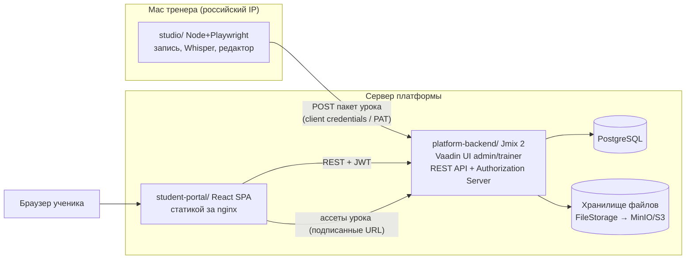
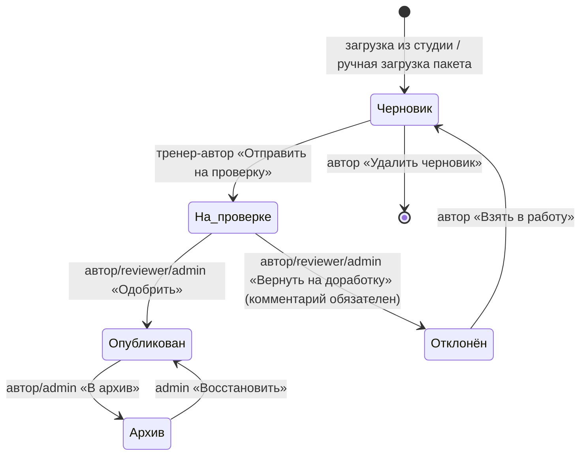
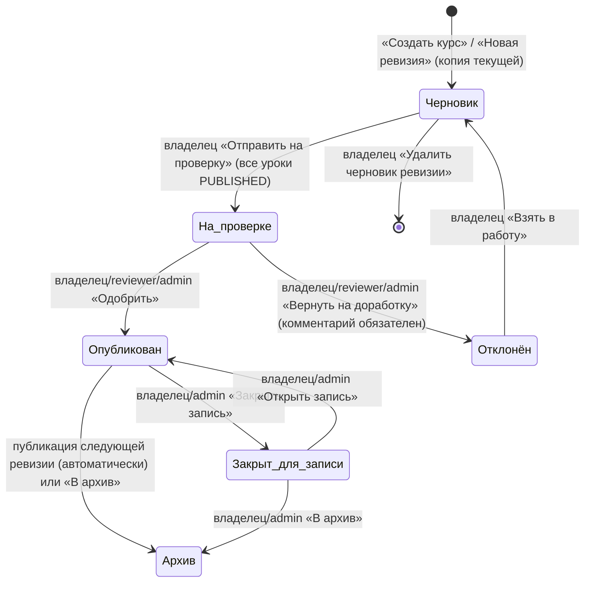

# Учебная платформа на базе ui-capture — дизайн-документ (черновик на согласование)

Автор: Grok Bot · Согласовал: Станислав Макаров · Дата: 04.11.2026 · Статус: согласован, дополнен запуском студии из админки (реализация — M2)

## 0. Что известно о текущем репозитории

Прочитано (только чтение) из `stanislav-makarov/ui-capture`, ветка `main`: `README.md`, `package.json`, `shared/lesson.ts`, `lessons/index.json`, дерево файлов.

Факты:
- `package.json`: версия `0.3.0`, Node ≥ 22, React 19, Vite, Playwright, `rrweb-snapshot`, `@xenova/transformers` (локальный Whisper), `vite-plugin-singlefile`.
- Студия: `npm start` → `tools/cli.ts studio`, локальная страница `http://127.0.0.1:44731/`; запись с микрофоном, аудио режется по шагам, Whisper (`npx ui-capture whisper-download`) кладёт реплику в подсказку шага. Есть редактор шагов и «Скачать trainer.html».
- Конвейер: `captures/<id>/` (rrweb-снимок, замороженный HTML, скриншот 1280×800, журнал действий, `net/`-ресурсы) → `build:lessons` → `lessons/<id>/` (`lesson.json`, `screens/sN.html`, `original/`, `replay/`, `compare/`, `assets/`) + `lessons/index.json` (каталог).
- `trainer.html` — один файл через `vite-plugin-singlefile`: экраны в `iframe srcdoc`, картинки как `data:`, аудио внутри.
- Схема `shared/lesson.ts`, `schemaVersion: 1`:
  - `Lesson { id, title, description, sourceSite, viewport, screens[], steps[], meta }`;
  - `LessonScreen { id, title, url, html, screenshot, hotspots[], viewport }`;
  - `Hotspot { id, kind(input|textarea|select|button|link|tab|clickable), label, selector, box{x,y,width,height} }`;
  - `LessonStep { id, index, screenId, action(input|click|select|key), hotspotId, expectedValue, confirm(match|enter|null), nextScreenId, instruction, hint, errorText, audio?, narration? }`;
  - `meta { generatedAt, generator, stepCount, manuallyEditedSteps, autoStepRatio, fidelity[], warnings[], defaultRenderMode(dom|screenshot) }`.
- Логика плеера уже в `shared/lesson.ts`: `judge()` → `correct|wrong-target|wrong-value|ignore`, подсказка в режиме `try` после 2 ошибок на шаге, в `test` — только «Неверно.», `RuntimeState { mistakes, firstTryCorrect }`. Режим отрисовки `auto`: скриншот, если сходство < 85%.
- Режимы: Покажи / Попробуй / Проверь (`show|try|test`), переключатель Разметка/Скриншот.

Допущения (не проверено, пометка **[доп.]**):
- **[доп.]** `screen.html`, `screen.screenshot`, `step.audio` — относительные пути внутри папки урока (а не inline-контент); в `trainer.html` они инлайнятся при сборке.
- **[доп.]** В видимом дереве нет `tools/cli.ts`, `tools/capture/*`, `tools/pack/*`, на которые ссылается `package.json` (видны только `tools/builder/*`). Возможно, дерево было обрезано или файлы не закоммичены — уточнить.
- **[доп.]** Формат аудио — WAV (есть `shared/wav.ts`).

## 1. Цели и границы

Цель: превратить студию записи в контур «записал → опубликовал → назначил → прошёл → видно прогресс» для группы учеников (сценарии ЕИС zakupki.gov.ru и др.).

MVP:
- публикация урока из студии на платформу (токен, пакет `.zip`);
- неизменяемые версии урока, курсы из упорядоченных уроков;
- роли admin / trainer / student, группы;
- назначение курса пользователю или группе со сроком;
- React-портал ученика: «мои курсы», прохождение в трёх режимах, отправка попыток и событий шагов;
- отчёты тренера в Jmix: прогресс по группе/курсу, попытки, «трудные шаги»;
- экспорт офлайн `trainer.html` сохраняется;
- жизненный цикл урока (с проверкой) и курса (с ревизиями).

Развёртывание не зависит от хостинга: для разработки — Docker Compose (postgres, backend, portal за nginx, опционально MinIO); площадка выбирается позже.

Позже: xAPI/LRS, SCORM-экспорт, SSO и AD/LDAP (на старте только локальные учётки Jmix; подключение позже через Jmix LDAP add-on без изменения модели), уведомления по почте, редактор шагов в веб-админке, сертификаты, мультиарендность, мобильная вёрстка портала, аналитика по тепловым картам ошибок.

## 2. Архитектура



Монорепозиторий `ui-capture`:
```
ui-capture/
  lesson-schema/        # общая схема: lesson.ts + JSON Schema (генерируется), тестовые уроки
  studio/               # текущий код: tools/, src/studio, bin/ (перенос без изменения логики)
  player/               # React-плеер (src/player, App) как пакет — используется studio, portal, trainer.html
  student-portal/       # React SPA: вход, курсы, прохождение, прогресс
  platform-backend/     # Jmix 2 (Gradle), Vaadin Flow, REST
  docs/                 # этот документ, ADR
```
npm workspaces для `lesson-schema`, `player`, `studio`, `student-portal`; Gradle — отдельно для `platform-backend`. Java-валидация пакета — по JSON Schema, сгенерированной из `lesson.ts` (одна правда — TS).

### 2.1. Запуск студии из админки (дополнение, реализация в M2)

Тренер в Vaadin-админке открывает курс и жмёт «Записать в студии». Админка не шлёт долгоживущий токен в ссылке.

1. Сервер выпускает одноразовый короткоживущий `ticket` (минуты, один обмен, привязан к курсу и пользователю).
2. Админка открывает `uicapture://new?course=…&server=…&ticket=…`. На Mac схема зарегистрирована на локальную студию (скелет plist и скрипт — `studio/macos/`, обмен ticket в M1 не делается).
3. Студия обменивает ticket на обычный `StudioToken`/короткий JWT через платформу и запоминает `course`.
4. Если схема не открылась, админка пингует `http://127.0.0.1:44731/api/health`. Ответ есть — передаёт то же задание локальному API студии. Нет ответа — показывает инструкцию: установить студию, `npm start`, повторить.
5. После «Стоп» студия собирает `.lesson.zip` и отправляет его в этот курс как версию в статусе «Черновик» (`POST /api/v1/studio/lessons/{externalId}/versions`).

Разобрать ссылку без регистрации схемы: `npx ui-capture open-url "uicapture://…"`.

Потоки:
1. **Запись**: студия → `captures/` → `lessons/<id>/` (как сейчас).
2. **Публикация**: студия собирает `<id>.lesson.zip` (`lesson.json` + `screens/` + `assets/` + аудио + скриншоты; без `captures/`, `compare/`, `replay/`) → `POST /api/v1/studio/lessons/{externalId}/versions`. Бэкенд валидирует схему, считает SHA-256, раскладывает файлы, всегда создаёт `LessonVersion` в статусе «Черновик» (см. §4).
3. **Проверка и назначение**: версия проходит проверку и публикуется; тренер включает её в ревизию курса, публикует ревизию и назначает курс группе/пользователю со сроком.
4. **Прохождение**: портал получает `lesson.json` выбранной версии, плеер грузит экраны/аудио по URL с бэкенда, шлёт результаты шагов пакетами.
5. **Прогресс**: бэкенд закрывает `Attempt`, пересчитывает `CourseProgress`; тренер видит отчёты.

## 3. Модель данных (Jmix)

| Сущность | Ключевые атрибуты (тип) | Связи |
|---|---|---|
| `User` | username (String, uniq), fullName, email, active (Boolean) | роли — через Jmix `RoleAssignment`; M:N `Group` |
| `Group` | name (String), description | M:N `User` (members), M:1 `User` (owner trainer) |
| `Course` | code (String, uniq), title, description (Text), owner (User) | 1:N `CourseRevision` |
| `CourseRevision` | revisionNo (Integer), status (DRAFT/IN_REVIEW/REJECTED/PUBLISHED/CLOSED/ARCHIVED), reviewedBy, reviewComment, passPolicy (ALL_TEST_PASSED/ALL_COMPLETED), defaultPassScore (Integer %, по умолчанию 80), publishedAt, changeNote | M:1 `Course`, 1:N `CourseLesson` |
| `CourseLesson` | position (Integer), required (Boolean), requiredMode (SHOW/TRY/TEST), passScore (Integer %, nullable — иначе берётся из ревизии курса) | M:1 `CourseRevision`, M:1 `Lesson`, M:1 `LessonVersion` (зафиксированная, только PUBLISHED) |
| `Lesson` | externalId (String, uniq — `id` из lesson.json), title, sourceSite, owner (User), currentPublished (LessonVersion), archived (Boolean) | 1:N `LessonVersion` |
| `LessonVersion` | versionNo (Integer), schemaVersion (Integer), content (JSONB — lesson.json), contentSha256, stepCount, status (DRAFT/IN_REVIEW/REJECTED/PUBLISHED/ARCHIVED), uploadedBy, reviewedBy, publishedAt, reviewComment (Text), metaOverride (JSONB: title, description, hint/errorText-правки), defaultPassScore (Integer %, nullable), studioVersion (String) | M:1 `Lesson`, 1:N `LessonAsset`, 1:N `StepRef` |
| `StepRef` (проекция) | stepId (String), index (Integer), action, instructionShort | M:1 `LessonVersion` — только для отчётов |
| `LessonAsset` | path (String, относительный в пакете), file (FileRef), mime, size, sha256 | M:1 `LessonVersion` |
| `Assignment` | dueDate (LocalDate), assignedAt, status (ACTIVE/CANCELLED) | M:1 `Course` (запись идёт на текущую опубликованную ревизию); M:1 `User` **или** M:1 `Group` (ровно одно), M:1 assignedBy |
| `Enrollment` | startedAt, completedAt, status (NOT_STARTED/IN_PROGRESS/COMPLETED/OVERDUE) | M:1 `User`, M:1 `CourseRevision` (зафиксирована на момент записи), M:1 `Assignment` (источник) |
| `Attempt` | mode (SHOW/TRY/TEST), renderMode (DOM/SCREENSHOT), status (IN_PROGRESS/FINISHED/ABANDONED), startedAt, finishedAt, durationMs, mistakes, firstTryCorrect, score (Integer %), passScoreApplied (Integer %), passed (Boolean), clientId (UUID, идемпотентность) | M:1 `User`, M:1 `LessonVersion`, M:1 `Enrollment` (nullable) |
| `StepResult` (вместо `StepEvent`) | stepId (String), stepIndex (Integer), correct (Boolean — шаг пройден), firstTry (Boolean), wrongCount (Integer), wrongTargetCount, wrongValueCount (Integer), hintShown (Boolean), timeMs (Long), completedAt | M:1 `Attempt`; одна строка на шаг. **Введённые учеником значения не хранятся.** |
| `LessonCompletion` | completedAt, source (ATTEMPT/MIGRATED), score (Integer %, nullable) | M:1 `Enrollment`, M:1 `Lesson`, M:1 `LessonVersion` (по которой засчитано), M:1 `Attempt` (nullable) |
| `EnrollmentMigration` | fromRevision, toRevision (CourseRevision), performedBy (User), performedAt, comment | 1:N `MigrationDecision`, M:N `Enrollment` (переведённые) |
| `MigrationDecision` | lesson (Lesson), fromVersion, toVersion (LessonVersion), decision (CREDIT/RETAKE), enrollment (nullable — переопределение для конкретного ученика) | M:1 `EnrollmentMigration` |
| `CourseProgress` | completedLessons, totalLessons, percent, bestScoreAvg, lastActivityAt, completed (Boolean) | 1:1 `Enrollment` (денормализация для отчётов) |
| `LifecycleTransition` | entityType (LESSON_VERSION/COURSE_REVISION), entityId (UUID), fromStatus, toStatus, actor (User), selfApproved (Boolean), at (OffsetDateTime), comment (Text) | аудит переходов; только вставка |
| `StudioToken` | name, tokenHash, expiresAt, lastUsedAt | M:1 `User` (тренер-владелец) |

`score` для Test: `firstTryCorrect / stepCount × 100` (как в `RuntimeState`; подтверждено). Порог: `CourseLesson.passScore` → `CourseRevision.defaultPassScore` → `LessonVersion.defaultPassScore` → 80%. Применённый порог пишется в `Attempt.passScoreApplied`, чтобы смена настроек не меняла задним числом прошлые результаты.

```mermaid
erDiagram
  USER }o--o{ GROUP : member
  COURSE ||--o{ COURSE_REVISION : revisions
  COURSE_REVISION ||--o{ COURSE_LESSON : contains
  LESSON ||--o{ LESSON_VERSION : has
  COURSE_LESSON }o--|| LESSON_VERSION : pins
  LESSON_VERSION ||--o{ LESSON_ASSET : files
  LESSON_VERSION ||--o{ STEP_REF : steps
  ASSIGNMENT }o--|| COURSE : of
  ASSIGNMENT }o--o| USER : to
  ASSIGNMENT }o--o| GROUP : to
  ENROLLMENT }o--|| USER : student
  ENROLLMENT }o--|| COURSE_REVISION : pinned
  ENROLLMENT }o--o| ASSIGNMENT : from
  ENROLLMENT ||--|| COURSE_PROGRESS : progress
  ENROLLMENT ||--o{ LESSON_COMPLETION : completed
  ENROLLMENT_MIGRATION ||--o{ MIGRATION_DECISION : decisions
  ENROLLMENT_MIGRATION }o--o{ ENROLLMENT : moves
  ATTEMPT }o--|| USER : by
  ATTEMPT }o--|| LESSON_VERSION : on
  ATTEMPT }o--o| ENROLLMENT : within
  ATTEMPT ||--o{ STEP_RESULT : steps
  USER ||--o{ LIFECYCLE_TRANSITION : actor
  STUDIO_TOKEN }o--|| USER : owner
```

**Шаги: JSON или реляционно.** Решение — `lesson.json` целиком в `JSONB` в неизменяемой `LessonVersion`, плюс тонкая проекция `StepRef` для отчётов.
- Схему владеет TS-код студии/плеера; дублировать её в JPA = двойная поддержка и риск расхождения при `schemaVersion: 2`.
- Версия неизменяема — нормализация ради редактирования не нужна; правка = новая версия из студии.
- Плееру нужен ровно этот JSON — отдаём без сборки.
- Отчётам («на каком шаге ошибаются») хватает `StepRef` + `StepResult.stepId`.
- Тексты (`hint`, `errorText`, название) можно поправить в черновике на платформе — правка пишется в `metaOverride` и применяется при выдаче JSON; после публикации — только новой версией.

**Хранение файлов.** Экраны 1–2,5 МБ HTML, ассеты, аудио: урок ≈ 5–15 МБ. MVP — Jmix `FileStorage` с локальной ФС (просто, бэкап вместе с томом); интерфейс тот же, поэтому переход на MinIO/S3 (`jmix-awsfs`) — конфигурацией, без изменения модели. Дедупликация по `sha256` внутри версии; между версиями — позже.

## 4. Жизненные циклы

Проверка обязательна и для версий урока, и для ревизий курса. Одобрять может **reviewer** (ресурсная роль Jmix, выдаёт admin), admin или **сам автор/владелец** — самоодобрение разрешено по умолчанию; контроль обеспечивается записью перехода в `LifecycleTransition` (кто, когда, комментарий; в журнале помечается `selfApproved=true`). Настройка `platform.review.allowSelfApprove` (по умолчанию `true`) оставлена на случай, если позже понадобится правило «четырёх глаз».

### 4.1. Версия урока (`LessonVersion.status`)



| Состояние | Что можно менять | Кто видит | Можно включить в курс |
|---|---|---|---|
| Черновик | тексты через `metaOverride` (название, описание, instruction/hint/errorText), `defaultPassScore`; удалить; заменить пакет нельзя — новая загрузка = новый черновик | автор, reviewer, admin; предпросмотр в Vaadin | нет |
| На проверке | ничего (только комментарий проверяющего) | автор, reviewer, admin | нет |
| Отклонён | ничего; комментарий виден автору | автор, reviewer, admin | нет |
| Опубликован | ничего (неизменяем); только перевод в архив | все, у кого есть доступ к курсу | да |
| Архив | ничего | автор, admin; ученики — только в уже закреплённых ревизиях | нет (в новые ревизии) |

Правила:
- Загрузка из студии **всегда** создаёт новую версию в «Черновике» с `versionNo = max + 1`; если `sha256` совпадает с существующей версией — 409 и ссылка на неё. Студия может сразу запросить «Отправить на проверку» (флаг `submitForReview=true`).
- Одновременно у урока может быть несколько черновиков, но в «На проверке» — не более одного.
- Публикация новой версии **не** меняет курсы автоматически (см. 4.2); у `Lesson.currentPublished` меняется ссылка, тренеру курсов, где урок есть, показывается отметка «есть новая версия».
- Архивирование версии, закреплённой в опубликованной ревизии курса, разрешено: незавершённые и будущие прохождения в этой ревизии продолжают работать (файлы не удаляются); предупреждение тренеру курса.
- Незавершённые попытки: попытка всегда привязана к конкретной `LessonVersion` и доигрывается на ней при любых переходах; попытки в статусе `IN_PROGRESS` старше 24 ч помечаются `ABANDONED` фоновой задачей.
- Каждый переход пишется в `LifecycleTransition`.

### 4.2. Курс (`CourseRevision.status`)

Курс — контейнер; содержимое версионируется **ревизиями**. Ревизия закрепляет конкретные `LessonVersion`.



| Состояние | Что можно менять | Новые назначения/записи | Прохождение |
|---|---|---|---|
| Черновик | состав и порядок уроков, версии, `required`, `requiredMode`, пороги, название, описание | нет | нет (предпросмотр тренера) |
| На проверке | ничего (комментарий проверяющего); предпросмотр курса целиком | нет | нет |
| Отклонён | ничего; комментарий виден владельцу | нет | нет |
| Опубликован | только срок в назначениях; состав, название, пороги — нет (через новую ревизию) | да | да |
| Закрыт для записи | как выше | нет; существующие назначения действуют | да, до завершения/срока |
| Архив | ничего | нет | записанные ранее могут доиграть, если `allowFinishAfterArchive=true` (по умолчанию да); в портале — «Курс архивирован» |

Переходы ревизии курса — через `CourseLifecycleService`, каждый пишется в `LifecycleTransition`. При «Одобрить» повторно проверяется, что все закреплённые версии уроков в статусе «Опубликован». Одновременно у курса не более одной ревизии «На проверке».

Как новая версия урока попадает в курс — **только явным действием тренера**:
1. Тренер видит «есть новая версия» у урока в курсе и нажимает «Обновить урок в курсе» (или «Новая ревизия»).
2. Если черновика ревизии нет — создаётся копия опубликованной (`revisionNo + 1`) с заменой версии урока; можно заменить несколько уроков сразу.
3. Публикация новой ревизии переводит предыдущую опубликованную в «Архив» (у курса одна опубликованная ревизия).

Ученики и прогресс при смене ревизии:
- `Assignment` указывает на курс: новые записи (и ещё не начавшие — `NOT_STARTED`) переходят на текущую опубликованную ревизию.
- Начавшие (`IN_PROGRESS`) остаются на своей ревизии до конца, пока тренер не выполнит «Перевести на новую ревизию».
- **Перевод — решение тренера.** Мастер перевода показывает, чем ревизии отличаются: уроки без изменений (та же `LessonVersion`) засчитываются автоматически; удалённые уроки выпадают из прогресса; новые уроки не пройдены. Для каждого урока, у которого **сменилась версия**, тренер выбирает «засчитать» или «пройти заново» — для всей выборки сразу и, при необходимости, отдельно для конкретного ученика. Выбор сохраняется в `EnrollmentMigration` / `MigrationDecision`, засчитанное переносом помечается в `LessonCompletion.source = MIGRATED`.
- Завершившие (`COMPLETED`) сохраняют статус и ревизию; повторное прохождение не требуется. Отчёт показывает ревизию, по которой засчитано.

## 5. Роли и права

Ресурсные роли (Jmix `@ResourceRole`) и строковые (`@RowLevelRole`):

| Объект / действие | admin | reviewer | trainer | student |
|---|---|---|---|---|
| Пользователи, группы: CRUD | всё | — | читать; группы — только свои (owner) | — |
| Назначение ролей | да | нет | нет | нет |
| Урок: загрузка черновика, правка текстов черновика, «на проверку», удалить черновик | всё | — | свои уроки | — |
| Версия урока: одобрить / вернуть на доработку | да | да | свои (самоодобрение) | — |
| Версия: в архив / восстановить | да / да | — | свои / нет | — |
| Курс: создать, черновик ревизии, обновить урок, «на проверку», закрыть запись, архив | всё | читать | свои курсы | читать назначенные (только опубликованные/доигрываемые) |
| Ревизия курса: одобрить / вернуть на доработку | да | да | свои (самоодобрение) | — |
| Assignment: создать/отменить | всё | — | свои группы и курсы | — |
| Перевод на новую ревизию (решения «засчитать»/«пройти заново») | всё | — | свои курсы и группы | — |
| Attempt / StepResult | читать всё | — | читать по своим группам | создать/читать только свои |
| CourseProgress / отчёты | всё | — | по своим группам | только свой |
| LifecycleTransition (журнал) | читать всё | читать по урокам и курсам | читать по своим урокам/курсам | — |
| StudioToken | всё | — | свои | — |
| Vaadin UI | все экраны | очередь «На проверке» (уроки и курсы), предпросмотр | курсы, уроки, группы, отчёты | нет (только портал) |

Row-level: `trainer` — `{E}.owner = :current_user` для `Group`, `Course`, `Lesson` (и через них `CourseRevision`, `LessonVersion`); для `Attempt` — `{E}.user in (select m from Group g join g.members m where g.owner = :current_user)`. `student` — `{E}.user = :current_user` для `Attempt`, `Enrollment`, `CourseProgress`. Переходы ЖЦ выполняются только через сервисы `LessonLifecycleService` / `CourseLifecycleService`, которые проверяют роль, текущее состояние и пишут журнал; прямое изменение `status` в UI/REST запрещено (атрибут read-only в ролях). Доступ ученика к `LessonVersion` проверяется в сервисе (есть `Enrollment` на ревизию с этой версией).

## 6. REST API

Аутентификация — Jmix Authorization Server (Spring Authorization Server), JWT:
- **Портал**: Authorization Code + PKCE, public client `student-portal`, access 15 мин, refresh 8 ч. Учётки — локальные пользователи Jmix (AD/LDAP — позже).
- **Студия**: персональный `StudioToken` (opaque, хэш в БД, срок, отзыв) в `Authorization: Bearer`; обмен на короткий JWT через `POST /api/v1/studio/token`. **Решение:** в MVP — персональный отзываемый токен (выпуск/отзыв тренером в Vaadin, показывается один раз, срок по умолчанию 90 дней). Причины: студия — локальный CLI/страница без пользовательского входа, токен проще и не требует браузерного редиректа на `127.0.0.1`. Device Code flow — после MVP.

Студия → платформа:
| Метод | Путь | Назначение |
|---|---|---|
| GET | `/api/v1/studio/ping` | проверка токена, версия схемы, лимит размера |
| GET | `/api/v1/studio/lessons?externalId=` | есть ли урок, версии и их статусы, sha, комментарий отклонения |
| POST | `/api/v1/studio/lessons/{externalId}/versions` | multipart `package.zip` (+ `Idempotency-Key`, `submitForReview`); 201 → `{lessonId, versionNo, status: DRAFT\|IN_REVIEW}`; 409 при совпадении sha |
| POST | `/api/v1/studio/lessons/{externalId}/versions/{n}/submit` | Черновик → На проверке |

Переходы ЖЦ (для Vaadin это вызовы тех же сервисов; REST — для автоматизации и студии):
| Метод | Путь | Кто |
|---|---|---|
| POST | `/api/v1/lesson-versions/{id}/transitions` `{action: submit\|approve\|reject\|reopen\|archive\|restore, comment}` | по матрице §5 (approve/reject — в т. ч. автор) |
| POST | `/api/v1/courses/{id}/revisions` (новый черновик ревизии, копия текущей) | trainer-владелец, admin |
| POST | `/api/v1/course-revisions/{id}/lessons/{lessonId}/upgrade` `{lessonVersionId}` | trainer-владелец, admin |
| POST | `/api/v1/course-revisions/{id}/transitions` `{action: submit\|approve\|reject\|reopen\|close\|open\|archive, comment}` | владелец, reviewer (approve/reject), admin |
| GET | `/api/v1/course-revisions/{id}/migration-preview?from={revId}` | список уроков: unchanged/changed/added/removed и затронутые ученики |
| POST | `/api/v1/course-revisions/{id}/migrations` `{fromRevisionId, enrollmentIds[], decisions:[{lessonId, decision: CREDIT\|RETAKE}], overrides:[{enrollmentId, lessonId, decision}], comment}` | владелец, admin |
| GET | `/api/v1/course-revisions/{id}/migrations` | история переводов с решениями |
| GET | `/api/v1/{lesson-versions\|course-revisions}/{id}/history` | журнал переходов |

Ручная загрузка `package.zip` — в Vaadin-экране «Уроки».

Портал → платформа:
| Метод | Путь | Назначение |
|---|---|---|
| GET | `/api/v1/me` | профиль, роли |
| GET | `/api/v1/me/courses` | назначенные курсы (ревизия ученика, статус курса), срок, прогресс |
| GET | `/api/v1/me/courses/{courseId}` | уроки ревизии ученика по порядку, статус и порог каждого |
| GET | `/api/v1/lesson-versions/{id}/content` | `lesson.json` с применённым `metaOverride` (ETag = sha+override) |
| GET | `/api/v1/lesson-versions/{id}/files/{path}` | экраны/аудио/картинки; `Cache-Control: immutable` |
| POST | `/api/v1/attempts` | старт: `{lessonVersionId, enrollmentId, mode, renderMode, clientId}` |
| POST | `/api/v1/attempts/{id}/step-results` | пакет `StepResult[]` (`stepId, correct, firstTry, wrongCount, wrongTargetCount, wrongValueCount, hintShown, timeMs`) — без введённых значений |
| POST | `/api/v1/attempts/{id}/finish` | `{durationMs}`; сервер считает `score`, применяет порог |
| GET | `/api/v1/me/progress` | сводка |

## 7. Портал ученика и прохождение

- `student-portal` использует пакет `player/` (текущий `Stage.tsx` + `reduceLesson`), меняется только источник данных: `LessonSource` — `InlineSource` (trainer.html, data:/srcdoc) и `HttpSource` (URL бэкенда).
- Экраны: `iframe` с `srcdoc` из `files/screens/sN.html` либо `src` на тот же origin; относительные ссылки на ассеты переписываются на `/files/...` при приёме пакета (**[доп.]** — проверить, как builder пишет пути в HTML экрана). `sandbox` без `allow-scripts`.
- Доступ к файлам: короткоживущий подписанный URL (для `<audio>`/``, которые не шлют заголовок авторизации).
- Результаты шагов: обёртка над `reduceLesson` агрегирует по шагу `wrongCount` (по вердиктам `wrong-target`/`wrong-value`), `hintShown` (сработал `hintFor`), `firstTry`, время шага. Значения ввода в отчёт не попадают и на сервер не отправляются. Очередь в `localStorage`, идемпотентность по `clientId`.
- Засчитывание: урок выполнен, если есть `Attempt.passed` в `requiredMode` (по умолчанию TEST) с порогом из §3. Show/Try пишутся, на прохождение не влияют.
- Курс в «Архиве» или урок в архивной версии — доигрывается по закреплённой версии; новые попытки в курсе «Закрыт для записи» разрешены уже записанным.
- Офлайн `trainer.html`. **Решение:** в MVP собирается только в студии (как сейчас); серверная сборка по ревизии курса — после MVP. Причины: сборка — Node-инструмент (`vite-plugin-singlefile`), на сервере понадобится отдельный Node-воркер/контейнер и очередь задач для файлов 10+ МБ; онлайн-прохождение покрывает портал, а офлайн-файл нужен редко. Для курса в студии добавляется команда `ui-capture pack --course <id>`: скачивает опубликованные версии ревизии по API и собирает файл. Офлайн-прохождения не засчитываются.
- xAPI позже: `Attempt`/`StepResult` маппятся в statements (`attempted`, `passed/failed`, `completed`); отправка в LRS — outbox на бэкенде.

## 8. Итерации MVP

Жизненные циклы добавляют ≈1,5 нед., проверка курса и мастер перевода с решениями тренера — ещё ≈1 нед.

1. **M1 — монорепо и схема (≈1–1,5 нед.)** Перенос в `studio/`, `player/`, `lesson-schema/` без изменения поведения; **техзадача:** сверить фактические пути экранов/аудио в `lesson.json` и наличие `tools/cli.ts`, `tools/capture/*`, `tools/pack/*` (в просмотренном дереве их нет, а `package.json` на них ссылается); JSON Schema из `lesson.ts`; команда `ui-capture package <id>` → `.lesson.zip`; Docker Compose для dev. *Демо:* старые команды и `trainer.html` работают, пакет валидируется.
2. **M2 — бэкенд, публикация и ЖЦ урока (≈2,5–3 нед.)** Jmix-проект, сущности, роли (admin/reviewer/trainer), FileStorage, `StudioToken`, загрузка из студии → черновик, `metaOverride`, очередь «На проверке», одобрение (включая самоодобрение)/отклонение с комментарием, журнал переходов, предпросмотр в Vaadin, выпуск/отзыв токена студии. Сюда же запуск с кнопки «Записать в студии»: `uicapture://` (одноразовый ticket), запасной путь через `127.0.0.1:44731`, после «Стоп» черновик в выбранный курс (§2.1). *Демо:* записал на Mac → черновик → на проверку → возврат с комментарием → исправленная версия одобрена автором, переход виден в журнале.
3. **M3 — курсы с ревизиями, портал и прохождение (≈3,5 нед.)** ЖЦ курса и ревизии с проверкой, «Обновить урок в курсе», Assignment/Enrollment с закреплением ревизии, Authorization Server + PKCE, `student-portal` с `HttpSource`, Attempt/StepResult, пороги. *Демо:* тренер отправляет курс на проверку и публикует, ученик проходит «Проверь»; тренер выпускает ревизию 2 с новой версией урока — начавший ученик доигрывает ревизию 1, новый получает ревизию 2.
4. **M4 — прогресс, перевод и отчёты (≈2 нед.)** CourseProgress, LessonCompletion, просрочки, мастер перевода на новую ревизию (решения «засчитать»/«пройти заново» по уроку и по ученику), отчёты тренера (группа × уроки, трудные шаги по `wrongCount`/`hintShown`/времени), экспорт CSV, архивация. *Демо:* тренер видит, кто не уложился в срок и где ошибаются, переводит группу на ревизию 2: изменённый урок 3 «засчитать», для одного ученика — «пройти заново».

Итого ≈ 9–10 недель (v2: 8–9, v1: 6,5–7).

## 9. Риски

- Размер уроков (HTML экранов до 2,5 МБ, урок до ~15 МБ) — gzip и immutable-кеш.
- Служебные данные на снимках экранов ЕИС — политика хранения и доступа к файлам уроков (введённые учеником значения не храним).
- Расхождение схемы TS ↔ Java при `schemaVersion: 2` — валидация только по сгенерированной JSON Schema, контрактные тесты.
- Сложность ревизий курса для тренера (лишние ревизии, путаница «какую версию видит ученик») — явная отметка «есть новая версия» и подсказки в UI.
- Самоодобрение снижает реальный контроль качества — компенсируется журналом переходов и отметкой `selfApproved` в отчётах; при росте команды включается «четыре глаза» настройкой.
- Дерево репозитория расходится с `package.json` (нет `tools/cli.ts` и др.) — техзадача M1.

## 10. Принятые решения и открытые вопросы

Решения (04.11.2026): хостинг выбирается позже (dev — Docker Compose); ЖЦ урока и курса с обязательной проверкой и самоодобрением; оценка Test = `firstTryCorrect / stepCount`, порог — настройка урока/курса; AD/LDAP — после MVP; храним только результат шага; перенос прогресса при смене версии урока — решение тренера; студия — персональный отзываемый токен; `trainer.html` в MVP собирается только студией.

Открытых вопросов к Станиславу нет. Техническая сверка путей и `tools/*` выполнена в M1, см. `docs/m1-paths.md`.
