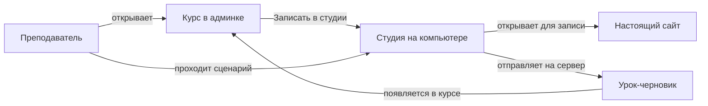

# Дизайн-документ студии

Дата: 06.11.2026

Студия — локальная утилита на компьютере преподавателя: он снимает урок с настоящей системы и отправляет его в курс на платформу. Ученик, проверяющий и директор студией не пользуются. Продуктовый дизайн платформы см. в [design-document.md](design-document.md).

## О студии

Студия — программа на компьютере преподавателя. Он открывает настоящую веб-систему, проходит сценарий как обычный пользователь и по желанию говорит комментарий. Студия снимает экраны и действия и собирает из этого урок тренажёра.

Зачем она локальная: запись идёт с машины преподавателя, где есть доступ к нужной системе. Для ЕИС это часто компьютер с российским IP и браузером, который открывает сайты с сертификатами ГОСТ. Студия не хранит пароль админки и не является кабинетом платформы.

## Имена

Студия — часть продукта uitrainer. Команда запуска станет `npx uitrainer`, схема открытия — `uitrainer://`, на переходный период сохранится алиас `uicapture://`. Подробная таблица замен — в [design-document.md](design-document.md#имена-и-пакеты).

## Установка

Студию ставят вручную на компьютер преподавателя. Платформа её не скачивает и не устанавливает: из браузера нельзя поставить программу, Node.js и браузер для записи.

1. Установить Node.js 22, например через nvm: `nvm install 22` и `nvm use 22`.
2. Склонировать репозиторий `ui-capture` и перейти в каталог проекта.
3. Выполнить `npm install`, затем `npx playwright install chromium`.
4. Запустить `npm start` — студия откроется на http://127.0.0.1:44731.
5. В админке в карточке курса нажать «Записать в студии». Если студия уже запущена, она получит задание сама.

Если студия не запущена, платформа показывает диалог «Студия не найдена» с теми же шагами: установить из репозитория, запустить `npm start` и нажать кнопку ещё раз. Отдельный установщик пока в бэклоге: для преподавателя установка всё ещё ручная.

## Границы

| Делает студия | Не делает студия |
| --- | --- |
| Открывает целевой сайт и снимает экраны, действия и голос | Не ведёт курсы, группы и учеников |
| Собирает урок и даёт поправить шаги после записи | Не публикует урок для учеников и не держит очередь проверки |
| Отправляет готовый пакет на сервер как черновик в курс | Не проводит ученика по уроку — это плеер на платформе |
| Может собрать офлайн-файл trainer.html для предпросмотра | Не просит и не показывает тикеты и токены обмена |

## Кто записывает

| Роль | Работа со студией |
| --- | --- |
| Преподаватель | Основной пользователь: записывает урок в свой курс и отправляет черновик на сервер |
| Администратор | Может записать тоже; токены студии хранит в разделе Администрирование, если нужно отозвать доступ |
| Проверяющий, директор, ученик | Студию не открывают и не записывают |

## Главный путь

В карточке своего курса преподаватель нажимает «Записать в студии». Открывается студия уже от его имени и для этого курса. Он записывает, останавливает запись, при необходимости правит шаги и отправляет урок на сервер. В админке появляется черновик. Дальше публикация для учеников идёт на платформе, не в студии.

## Как связана с платформой

Связь со сервером настраивается сама: админка передаёт студии задание на запись в конкретный курс. Если студия не запущена, преподаватель видит инструкцию запустить её и нажать кнопку снова. Служебный обмен тикета на право публикации скрыт: это не экран и не термин, который он должен знать.

## Что видит преподаватель

| Шаг | Что происходит на экране |
| --- | --- |
| Старт | В курсе кнопка «Записать в студии». Отдельно создавать урок с главного экрана админки нельзя |
| Подготовка | Указывает адрес сайта, название, при необходимости браузер и микрофон. Для сайтов с сертификатами ГОСТ выбирает Яндекс Браузер |
| Запись | Сайт открывается отдельным окном. На экране висит жёлтая плашка «Учебный тренажёр» со стопом записи |
| После записи | Можно посмотреть шаги, поправить подсказки, пройти предпросмотр и нажать «Опубликовать на сервер» |
| Что снимается | Основной путь — снимок экрана и журнал действий. Если страницу так не снять (холст, canvas, ЭЦП), студия опирается на скриншоты с отметками на кнопки и поля |

## Что уже есть и чего ещё нет

| Тема | Сейчас в коде | Как должно быть для преподавателя |
| --- | --- | --- |
| Старт из курса | Кнопка «Записать в студии» передаёт курс и открывает студию | То же: студия сразу знает, кто записывает и куда класть урок |
| Тикет и токен | Обмен есть, файл связи хранится локально и не попадает в git | Преподаватель не видит тикет и не должен его понимать |
| Стоп записи | Кнопка стопа на жёлтой плашке | То же |
| Голос | Микрофон и распознавание речи по желанию; без модели запись сохраняется | Голос необязателен |
| Отправка на сервер | «Опубликовать на сервер» создаёт черновик; повтор — новую версию | То же: это ещё не публикация для учеников |
| Установка | Клон репозитория, npm install, npm start; платформа только показывает инструкцию, если студия не найдена | Сейчас ручной путь; установщик для преподавателя — в бэклоге |
| Локальная запись без курса | В студии есть «Новый урок» без платформы | Открытый вопрос, остаётся ли это рабочим путем наряду с записью из курса |

## Таблица use cases

| Код | Сценарий | Цель | Откуда входит | Основные шаги | Результат |
| --- | --- | --- | --- | --- | --- |
| UC-ST1 | Начать запись из курса | Снять урок для конкретного курса | Кнопка «Записать в студии» в карточке курса | Студия открывается уже для этого курса и от имени преподавателя | Можно начинать запись, не настраивая связь вручную |
| UC-ST2 | Студия не запущена | Понять, что сделать | Та же кнопка, если студия не отвечает | Админка показывает инструкцию запустить студию и повторить | Преподаватель не видит служебных ошибок обмена |
| UC-ST3 | Записать прохождение | Снять экраны и действия | Экран подготовки записи | Выбирает сайт и браузер, при желании микрофон, нажимает старт и проходит сценарий | Есть черновая запись прохождения |
| UC-ST4 | Остановить запись | Закончить съёмку, не ища кнопку по окнам | Жёлтая плашка на экране записи | Нажимает стоп на плашке «Учебный тренажёр» | Запись останавливается, студия собирает урок |
| UC-ST5 | Поправить шаги | Уточнить подсказки и порядок действий | Карточка урока в студии после съёмки | Смотрит шаги, правит тексты, при необходимости проверяет предпросмотр | Урок готов к отправке |
| UC-ST6 | Отправить на сервер | Положить урок в курс на платформе | Кнопка «Опубликовать на сервер» | Студия собирает пакет и отправляет его в привязанный курс | В админке появляется черновик; ученики его ещё не видят |
| UC-ST7 | Отправить исправленную версию | Заменить черновик новой съёмкой | Тот же урок в студии | Снова «Опубликовать на сервер» | На платформе появляется новая версия-черновик |
| UC-ST8 | Выбрать браузер для ЕИС | Открыть сайт с сертификатами ГОСТ | Список браузеров на экране подготовки | Выбирает Яндекс Браузер или другой подходящий браузер | Запись идёт в окне, где сайт открывается |

## Правила и открытые вопросы

| Тема | Статус |
| --- | --- |
| Преподаватель не работает с тикетами | Решено: кнопка открывает студию сама |
| Токены студии в меню | Решено: раздел Администрирование, не стартовый экран |
| Остаётся ли запись без курса, только локально в студии | Открытый вопрос |
| Где править шаги после первой отправки: в студии или ещё и на платформе | Открытый вопрос |
| Нужна ли студия на Windows так же, как на Mac | Открытый вопрос; установщик сначала имеет смысл на Mac |

## Бэклог

| Пункт | Что сделать | Статус |
| --- | --- | --- |
| Установщик студии | Собрать пакет для преподавателя (на Mac — `.dmg` или `.pkg`): студия, Node и браузер для записи, регистрация ссылки `uitrainer://`. В админке — «Скачать студию», если локальная студия не найдена. Первую установку преподаватель подтверждает сам. Сейчас установка остаётся ручной из репозитория. | Не сделано |
